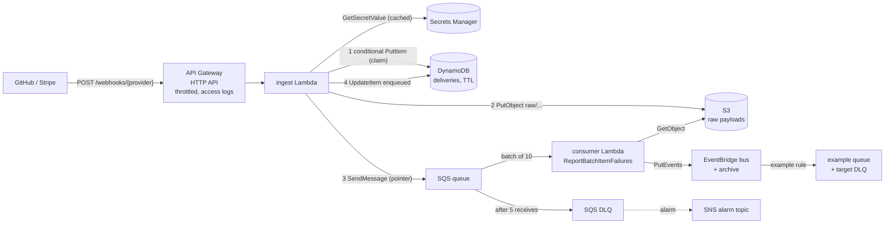

# serverless-webhook-relay

[](https://github.com/rahulkumar96t/serverless-webhook-relay/actions/workflows/ci.yml)

A reference architecture, written in AWS CDK v2 (TypeScript), for receiving third-party webhooks
reliably. An HTTP API hands each delivery to an ingest function that verifies its HMAC signature
(GitHub and Stripe schemes), claims the delivery id in DynamoDB so retries and replays are
processed once, archives the exact raw body in S3 and enqueues a pointer on SQS. A consumer
function publishes the deliveries to an EventBridge bus with per-message failure reporting, so
downstream teams subscribe with ordinary EventBridge rules. Dead-letter queues, alarms, structured
logs and least-privilege IAM are part of the stack.

This is a reference implementation: the repository is tested with unit tests and assertions on
the synthesized CloudFormation template. Nothing here deploys automatically, and no figures about
production behaviour are claimed.

## Features

- **Signature verification** over the raw request bytes, constant-time comparison:
  - GitHub style: `X-Hub-Signature-256: sha256=<hex>`; replay protection through de-duplication
    on `X-GitHub-Delivery`.
  - Stripe style: `Stripe-Signature: t=<ts>,v1=<hex>` over `"<t>.<body>"`, with a timestamp
    tolerance window (default 300 s) and support for several `v1` values.
  - Several secrets per provider (a JSON array in Secrets Manager) for zero-downtime rotation.
- **De-duplication** with a DynamoDB conditional put on `<provider>#<delivery id>` and a TTL;
  a failed attempt releases its claim so the sender's retry is processed (see
  [design decisions](#design-decisions-and-trade-offs)).
- **Size limit** (default 1 MiB) checked against `Content-Length` before any work, and again on
  the decoded body.
- **Raw archive**: the signed bytes are stored in S3 (private, SSE-S3, TLS-only, lifecycle expiry).
- **Queueing**: SQS with SSE, a dead-letter queue after 5 receives, and visibility timeout set to
  six times the consumer timeout.
- **Fan-out**: EventBridge custom bus, event archive for replay, and an example rule (GitHub pushes
  to `main` delivered to a queue with retry policy and its own DLQ).
- **Operations**: JSON logs with per-function log groups, API access logs, six CloudWatch alarms
  to an SNS topic (DLQ not empty, function errors, API 5xx, queue age, signature-rejection spike).
- **Least privilege**: custom roles per function, scoped to exact actions and resources, no
  managed policies, S3 access limited to the `raw/` prefix (asserted in tests).

## Architecture



Request outcomes:

| Response | When |
| --- | --- |
| `202 accepted` | verified, claimed, archived and enqueued |
| `200 duplicate` | this delivery id was already enqueued (sender retry or replay) |
| `409 delivery_in_progress` | another attempt holds a fresh claim; the sender should retry later |
| `401 invalid_signature` | missing, malformed or wrong signature, or Stripe timestamp outside the window (reason logged, not returned) |
| `400 malformed_delivery` | signed, but the delivery id or event type cannot be read |
| `404 unknown_provider` | no provider with that name is configured |
| `413 payload_too_large` | body above the configured limit |
| `500 internal_error` | an AWS call failed; the claim was released so a retry is processed |

Published events look like this (`source` is `webhook-relay.<provider>`, `detail-type` is the
GitHub event name or Stripe event type):

```json
{
  "source": "webhook-relay.github",
  "detail-type": "push",
  "detail": {
    "deliveryId": "6f0c1c2e-...",
    "provider": "github",
    "receivedAt": "2026-03-01T10:00:00.000Z",
    "raw": { "bucket": "...", "key": "raw/github/2026/03/01/6f0c1c2e-...", "sizeBytes": 7342, "contentType": "application/json" },
    "payload": { "ref": "refs/heads/main", "...": "..." }
  }
}
```

## Quickstart (local)

Requires Node.js 22+. No AWS account or credentials are needed for any of this.

```bash
npm ci
npm run build    # strict type-check of the app, handlers, tests
npm run lint
npm test         # handler unit tests + CDK assertions
npm run synth    # writes cdk.out/WebhookRelay.template.json; bundles both functions with esbuild
```

## Deploying (not done by this repository)

The stack is environment-agnostic, so it deploys to whichever account and region your AWS
profile points at.

```bash
npx cdk bootstrap                                  # once per account/region
npx cdk deploy -c alarmEmail=you@example.com       # alarmEmail is optional
```

Stack outputs include `WebhookUrlTemplate`, the `EventBusName`, the DLQ URL and one secret ARN per
provider. Then wire up the senders:

- **GitHub** (repository or organisation settings, Webhooks): payload URL
  `<WebhookUrlTemplate with {provider} = github>`, content type `application/json`, and as secret
  the generated value:
  `aws secretsmanager get-secret-value --secret-id <GithubSecretArn> --query SecretString --output text`.
- **Stripe** (Developers, Webhooks): endpoint URL with `{provider} = stripe`, then store the
  signing secret Stripe shows you:
  `aws secretsmanager put-secret-value --secret-id <StripeSecretArn> --secret-string 'whsec_...'`.

Functions cache secrets for five minutes. To rotate without dropping deliveries, store
`["new-secret","old-secret"]`, switch the sender, then remove the old value.

To try a deployed stack by hand:

```bash
npm run send-test-webhook -- https://<api-id>.execute-api.<region>.amazonaws.com/webhooks/github github '<secret>'
```

Messages that land in the DLQ can be moved back after a fix with
`aws sqs start-message-move-task --source-arn <dlq-arn>`.

Providers, limits and retention are constructor props of `WebhookRelayStack`
(`providers`, `maxBodyBytes`, `rawPayloadRetention`, `dedupeWindow`, `throttle`, `alarmEmail`);
see `bin/app.ts`.

## Design decisions and trade-offs

- **Claim, then work, then release on failure.** A plain "insert the delivery id if absent"
  loses deliveries: if archiving or enqueueing fails after the insert, the sender's retry looks
  like a duplicate. Here the claim is written as `pending` with a timestamp; on success it becomes
  `enqueued`, and on failure the function deletes its own claim (conditioned on its timestamp) and
  answers 500. If even the release fails, the claim becomes stale after two minutes (longer than
  the function timeout) and a retry may take it over. A fresh `pending` claim answers 409 rather
  than 200, so a concurrent duplicate never acknowledges a delivery that might still fail.
  Stripe retries non-2xx responses on its own; GitHub does not, and failed deliveries are
  redelivered from the webhook settings or its API.
- **At-least-once to EventBridge.** SQS and Lambda retry, and `PutEvents` has no idempotency key,
  so a delivery can reach the bus more than once in failure cases. Every event carries
  `deliveryId` so consumers can de-duplicate; exactly-once would need a transactional outbox per
  consumer.
- **Claim-check pattern.** The queue message is a small envelope pointing at the S3 object, not
  the payload. Message size never depends on webhook size, the archive holds exactly the bytes
  that were signed (useful for audits and replays), and the consumer can omit huge payloads from
  the event (EventBridge's 256 KB entry limit) while still pointing at the original.
- **Verify before anything else touches the payload.** Signatures are computed over the raw bytes
  (base64 bodies are decoded first); the JSON is parsed only after verification. The Stripe
  verifier checks the signature before the timestamp, so unauthenticated callers learn nothing
  about the time window, and 401 responses never say why.
- **Partial batch responses.** The consumer reports individual message ids as failed, so one
  poison message is retried and dead-lettered alone instead of re-driving the whole batch.
  `PutEvents` result entries are matched to messages by position, per chunk of ten.
- **Custom roles instead of the managed basic-execution policy.** Each function may write only to
  its own log group; everything else is granted per resource. The tests fail on any wildcard
  action, `Resource: "*"` or managed policy.
- **Bundled AWS SDK.** esbuild bundles the pinned SDK clients (about 1.1 to 1.2 MB minified per
  function, as printed by `cdk synth`) instead of using the runtime's copy: reproducible
  behaviour in exchange for a larger package.
- **Secrets Manager rather than environment variables** for signing secrets, so they never
  appear in the template, the console or `GetFunctionConfiguration` output.

## Testing

```bash
npm test   # 87 tests, vitest
```

- `test/signatures.test.ts`: both schemes, including GitHub's documented test vector, single-byte
  tampering, wrong secret, malformed headers, tolerance boundaries in both directions, future
  timestamps, timestamp/signature binding, multiple `v1` values, rotation, raw non-UTF-8 bodies.
- `test/ingest.test.ts`: the handler with DynamoDB, S3, SQS and Secrets Manager mocked by
  `aws-sdk-client-mock`: call order of the happy path, base64 bodies, secret caching, every
  rejection path, duplicate and in-progress claims, oversize payloads (header and body),
  release-on-failure for S3 and SQS errors, a failed release, a failed `enqueued` mark.
- `test/consumer.test.ts`: batching into chunks of ten, positional failure mapping (also in the
  second chunk), poison messages, missing S3 objects, `PutEvents` throwing, payload omission.
- `test/stack.test.ts`: CDK assertions on the synthesized template: route, throttling, access
  logs, runtimes, event source mapping, redrive policy, TLS-only policies, TTL, bucket hardening,
  exact IAM actions per role, archive, example rule, alarms and metric filter.

CI runs lint, the type-check, the tests and `cdk synth` on Node 22. Locally the suite was run on
Node 22.23.4 and 25.6.1 (macOS, Apple M4 Pro) and completes in about 3 seconds.

## Limitations and roadmap

- Not load-tested and not deployed as part of this repository; behaviour against real GitHub and
  Stripe endpoints has not been verified here, only against their documented signature formats.
- No exactly-once delivery to the bus (see above).
- One region; no custom domain or WAF in front of the API (both are a few lines of CDK).
- No tracing; adding X-Ray or OpenTelemetry would need IAM statements on `*`, which the IAM test
  currently forbids by design.
- More schemes (Slack, Shopify, Standard Webhooks) fit the `ProviderConfig` union; each needs a
  verifier and a metadata extractor.
- The DLQ is redriven by hand; an operator tool or a scheduled redrive would help.

## License

MIT, see [LICENSE](LICENSE).
